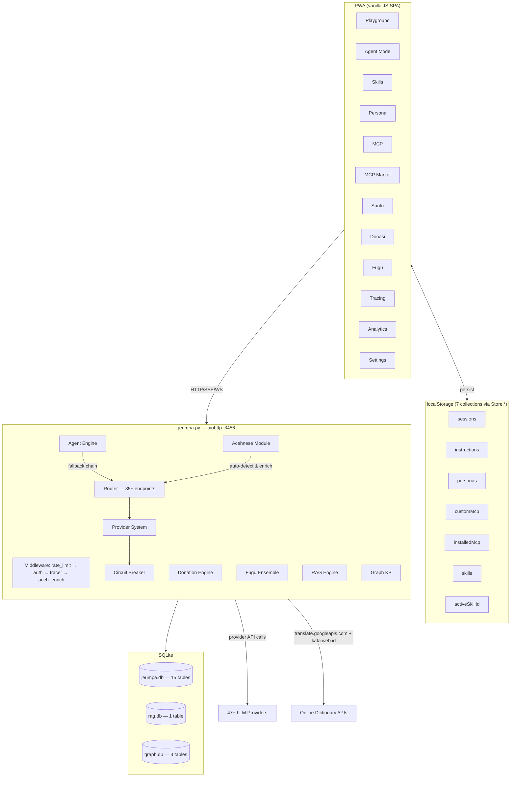

# JeumpaLLM Architecture v2.5

## Graph



## Page Map (15 pages)

| Page | Route | Key Feature |
|------|-------|-------------|
| Overview | `#overview` | System health, provider status, quick actions |
| Providers | `#providers` | Provider cards, ping, status |
| Models | `#models` | Model list, search, capabilities |
| Playground | `#playground` | Chat with session persistence, instruction/persona selector, skill badge |
| API | `#api` | Interactive API reference with curl/fetch examples |
| MCP | `#mcp` | MCP tools view + custom MCP server management |
| MCP Market | `#mcp-market` | Browse/install/uninstall 10 default MCP tools |
| Compare | `#compare` | Side-by-side model comparison |
| Workflows | `#workflows` | DAG-based workflow orchestration |
| Tools | `#tools` | Tool registry with try-it UI |
| Agent | `#agent` | Coding agent (Hermes methodology) + Telegram bot config |
| Persona | `#persona` | Custom AI personas with system prompt |
| Skills | `#skills` | 6 default + custom skills, activate/deactivate |
| Santri | `#santri` | Registration, verification, status |
| Donasi | `#donasi` | Multi-payment method selector (Dana/OVO/GoPay/QRIS/BSI/etc) |
| Fugu | `#fugu` | Multi-model ensemble query |
| Tracing | `#tracing` | Distributed tracing spans |
| Analytics | `#analytics` | Usage stats, provider ranking, model popularity |
| Settings | `#settings` | Server URL, auth (x-api-key), instructions, defaults, Acehnese toggle |
| Logs | `#logs` | Request log viewer |

## localStorage Collections (7 via `Store.*`)

| Collection | Key | Structure |
|------------|-----|-----------|
| sessions | `jmpp_sessions` | `[{id, title, messages[], model, temperature, maxTokens, systemPrompt, personaId, createdAt, updatedAt}]` |
| instructions | `jmpp_instructions` | `[{id, name, prompt}]` |
| personas | `jmpp_personas` | `[{id, name, systemPrompt, greeting}]` |
| customMcp | `jmpp_custom_mcp` | `[{id, name, url, tools[], createdAt}]` |
| installedMcp | `jmpp_installed_mcp` | `[string ids]` |
| skills | `jmpp_skills` | `[{id, name, icon, desc, systemPrompt}]` |
| activeSkill | `jmpp_active_skill` | `string \| null` |
| api_key | `api_key` | `email:password` string |
| server_url | `server_url` | Backend URL string |

## Agent System

```
User Task → /v1/agent/code
  → check_agent_access(user)         # donor tier or token_balance > 0
  → HERMES_CODER prompt injection    # methodology: analyze/plan/code/verify
  → router.chat_completion(model)    # primary provider
    → on error: fallback to next     # up to max_fallbacks
    → track _providers_used[]
  → tool loop (up to 5 iterations)   # read/write/run/search/list
  → response: {code, files_created[], providers_used[], explanation}
```

### Agent Endpoints (7)

| Method | Path | Description |
|--------|------|-------------|
| POST | `/v1/agent/code` | Coding agent with multi-provider fallback |
| POST | `/v1/agent/chat` | Chat agent with tool use + streaming |
| GET | `/v1/agent/tools` | List available agent tools |
| GET | `/v1/agent/subscribe` | Check subscription status + pricing plans |
| POST | `/v1/agent/telegram` | Register Telegram bot token + set webhook |
| POST | `/v1/agent/telegram/webhook` | Handle Telegram updates → agent reply |

## Acehnese (Bahasa Aceh) Module

```
User Message → /v1/aceh/detect
  → detect_aceh(text)              # match against 150+ known Acehnese words
  → confidence ≥ 0.15?              # threshold for "is this Acehnese?"

Enrichment Pipeline (auto in chat middleware):
  → enrich_prompt(messages)        # only runs if aceh_enabled=true and Aceh detected
  → re.findall() unique words      # extract candidate words from message text
  → filter against COMMON_ACEH_WORDS  # keep only known Acehnese words
  → asyncio.gather(lookup_word())  # parallel lookups (batches of 5)
    → gt_translate()               # Google Translate API (primary, free, no key)
    → scrape_kata_webid()          # kata.web.id HTML scraping (secondary, more detailed)
  → glossary[] → format enrichment string → inject into system message
  → router.chat_completion()       # proceeds with enriched context
```

### Acehnese Endpoints (5)

| Method | Path | Description |
|--------|------|-------------|
| POST | `/v1/aceh/detect` | Detect if text is Acehnese → confidence score + matched words |
| GET | `/v1/aceh/lookup?word=` | Dictionary lookup: Google Translate + kata.web.id |
| POST | `/v1/aceh/translate` | Translate Aceh ↔ Indonesia/English |
| POST | `/v1/aceh/enrich` | Full pipeline: detect → extract → lookup → injectable glossary |
| GET | `/v1/aceh/glossary` | Module info, word count, sources, endpoints |

### Online Sources

| Source | Type | Auth | Quality |
|--------|------|------|---------|
| Google Translate API (`translate.googleapis.com`) | REST (free) | None | Good for sentences, good for words |
| kata.web.id (`kata.web.id/kamus/aceh-indonesia/`) | HTML scrape | None | More detailed definitions, word-level |
| Acehnese word list (built-in) | Local frozenset | — | 150+ words for detection only |

## Router — Provider Fallback Chain

```
select(model, strategy)
  → _get_candidates(model)          # all providers with matching model
  → _resolve_model(model)           # alias resolution
  → _split_exact(model, candidates) # exact match > wildcard
  → strategy selector:
    round_robin | priority | random | latency

chat_completion(messages, model, max_fallbacks=3)
  → loop:
    → provider = select(model)
    → result = provider.chat()
    → if error AND fallback_enabled:
      → provider.status = DEGRADED
      → select() next provider (exclude used)
      → retry
    → success: return {choices[], _provider, _model}
    → all failed: return {error: "all_providers_failed", used: []}
```

## Module Dependency

```
jeumpa.py
  ├── agent.py          → Hermes coder, subscription, Telegram webhook
  ├── aceh.py           → Acehnese language detection, dict lookup, translation, prompt enrichment
  ├── donate.py         → 9 payment methods, auto-detect webhook
  ├── santri.py         → Registration + verification
  ├── fugu_mode.py      → Multi-model ensemble (5 strategies)
  ├── router.py         → 85+ endpoints, provider routing
  │   ├── providers/    → 10+ provider modules
  │   ├── rag.py        → Document RAG
  │   ├── graph_kb.py   → Knowledge graph
  │   ├── a2a_protocol.py → A2A agent protocol
  │   ├── marketplace.py  → Package registry
  │   ├── orchestration.py → DAG workflows
  │   ├── tool_framework.py → Tool registry
  │   └── anthropic_compat.py → Messages API
  ├── models.py         → SQLAlchemy ORM (15 tables)
  ├── jeumpa_paths.py   → Auto-path detection
  └── jeumpa_tunnel.py  → Auto-tunnel detection
```

## Auth Flow

```
Client → x-api-key: email@example.com:password
  → auth middleware checks header
  → if ":" in header → email:password auth (no DB lookup for API key)
    → find user by email + verify password hash
    → set request["user"] = {id, email, tier, token_balance, ...}
  → else → generated API key lookup (key_hash)
  → route handler uses request["user"]

Public prefixes: /auth/, /static/, /chat, /v1/chat, /v1/agent, /mcp/,
                 /donate/, /santri/, /v1/conversations, /v1/health,
                 /v1/paths, /v1/tunnel, /v1/discovery
```

## Database (jeumpa.db — 15 tables)

| Table | Key Fields |
|-------|-----------|
| users | id, email, password_hash, tier, token_balance, tier_expires_at |
| api_keys | id, user_id, key_hash, key_prefix, rate_limit_max, expires_at |
| sessions | id, user_id, token, expires_at |
| conversations | id, user_id, title, model, created_at |
| messages | id, conversation_id, role, content, tokens |
| usage_log | id, user_id, api_key_id, date, tokens_in, tokens_out |
| donations | id, user_id, amount, token_amount, payment_ref, status |
| santri_profiles | id, user_id, full_name, pesantren_name, verification_status |

## Access Tiers

| Tier | Rate | Agent Mode | Duration | Cost |
|------|------|------------|----------|------|
| Visitor | 10 req → login prompt | ✗ | — | Free |
| Free (registered) | 100 req/day | ✗ | — | Free |
| Santri (Aceh) | 1000 req/day | ✓ | 1 year | Free |
| Donor | depends on token balance | ✓ | 30-90 days/donation | IDR 10K+ |

## Tech Stack

| Component | Technology |
|-----------|-----------|
| Python Server | aiohttp 3.12+ |
| Database | SQLite via SQLAlchemy + aiosqlite |
| Auth | x-api-key: email:password (header-based) |
| Embeddings | Built-in token-frequency + optional Jina AI |
| Tunnel | Cloudflare Tunnel (cloudflared) |
| Frontend | Vanilla JS SPA — 20 pages, no framework, no build |
| Storage | localStorage via Store.* namespace (7 collections) |
| Agent | Hermes Nous Research methodology |
| Payments | 9 channels: DANA, OVO, GoPay, ShopeePay, QRIS, LinkAja, BSI, Mandiri, BCA |
| Acehnese | Google Translate API (free) + kata.web.id — 0 dataset, 0 API keys |

*JeumpaLLM — Dhaher Labs · AGI → ASI · AI untuk Semua, Khususnya Aceh*
